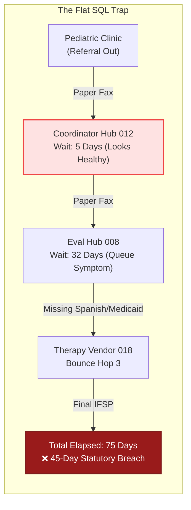
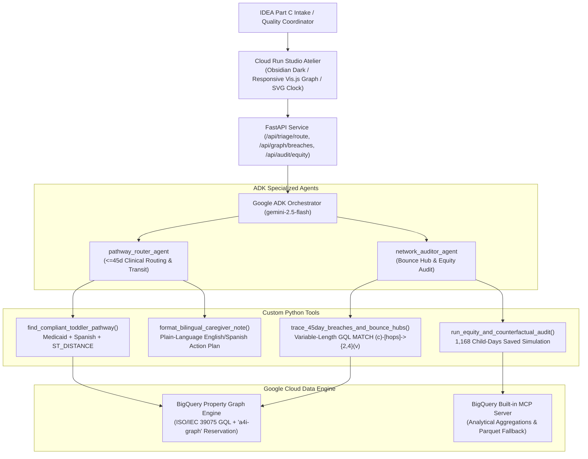

# First Milestones: IDEA Part C Early Intervention Triage & Network-Audit Studio

**Agents for Impact 2026 · Challenge 04 Submission Deck**

---

## 📌 Executive Pitch Summary

Federal law gives states **forty-five calendar days** from the moment an infant or toddler (0–35 months) is referred for a developmental concern to deliver a comprehensive multidisciplinary evaluation and an initial **Individualized Family Service Plan (IFSP)** under Part C of the Individuals with Disabilities Education Act (IDEA, 34 CFR § 303.310).

Across high-poverty urban and rural communities, over **70% of multi-hop referral chains breach this statutory clock**, frequently stretching to 70–75+ days. When regional coordinators inspect flat provider spreadsheets, the bottleneck is obscured by the **Flat SQL Waitlist Illusion**: downstream evaluation centers with backlogs are merely symptoms; the true culprits are upstream **"Bounce Hubs"**—intake desks with deceptively low internal wait times (5–6 days) whose reliance on paper faxing and mismatched bilingual/Medicaid routing triggers cascading multi-hop re-referrals. If a toddler reaches **36 months**, they permanently fall off the IDEA Part C age-out cliff and lose eligibility forever.

**First Milestones** solves this with a conversational AI triage and network-audit assistant powered by **Google ADK (`gemini-2.5-flash`)** and a **BigQuery Property Graph (`ReferralGraph`)** declared in native **ISO/IEC 39075 GQL**.

---

## 📑 Slide Deck (6-Slide Presentation Document)

### Slide 1 · Title & Project Overview

* **Project Title:** First Milestones: IDEA Part C Early Intervention Triage & Network-Audit Studio
* **Subtitle:** Beating the 45-Day Statutory Clock for Vulnerable Toddlers via BigQuery ISO GQL & Google ADK
* **Challenge Track:** Challenge 04 — Early Intervention & Developmental Screening Triage
* **Target Deployments:** New York (NY · FIPS 36, Bronx County) & Mississippi (MS · FIPS 28)
* **Live Service URL:** [https://early-intervention-triage-ny-584075988667.us-central1.run.app](https://early-intervention-triage-ny-584075988667.us-central1.run.app)
* **GitHub Repository:** [https://github.com/Sree-Hari-Priya/agents_for_impact](https://github.com/Sree-Hari-Priya/agents_for_impact)

---

### Slide 2 · Our Team

#### Official Team Picture & Event Recognition

   
  
    
  
<b>Team Lead:</b> Sree Hari Priya &nbsp;|&nbsp; <b>Team:</b> Agents for Impact Team

  
<b>Direct Google Photos Link:</b> <a href="https://photos.google.com/photo/AF1QipMMHSDoYXfUEey-G92DeXZLErrHQjA_jP1IpuUi"><code>https://photos.google.com/photo/AF1QipMMHSDoYXfUEey-G92DeXZLErrHQjA_jP1IpuUi</code></a>

   

> [!IMPORTANT]
> **Event Permissions & Filming Confirmation:**
> - **Filming Availability (Thursday 11/19 between 11:00 AM – 2:00 PM at MP7):** **YES** (Team is available to return to Google Event Center MP7 to film winning pitch).
> - **Project Sharing:** **YES** (Approved for internal Google sharing & team dissemination).
> - **Discord Notifications:** Team is actively monitoring Discord announcements prior to 9:00 PM.

---

### Slide 3 · Real-World Challenge

#### The 45-Day Statutory Clock Crisis & The Flat Waitlist Illusion

1. **Federal Mandate (IDEA Part C, 34 CFR § 303.310):**
   States must evaluate infants and deliver an IFSP within **45 calendar days**. Early intervention at 20 months rewires neurodevelopment; waiting until kindergarten is too late.
2. **The 36-Month Part C Age-Out Cliff:**
   Toddlers permanently age out of Part C at 36 months (age 3). An administrative delay of 45+ days permanently disqualifies a 30-month-old from early intervention services.
3. **The Flat SQL Waitlist Illusion:**
   Sorting flat directories by waitlist highlights downstream evaluation clinics (waitlist = 75). These are merely symptoms. Intermediary **"Bounce Hubs"** with deceptive 5-day queues quietly paper-fax packets into backlogged hubs.
4. **Cascading Violations & Equity Disparities:**
   Missing bilingual or Medicaid credentials causes 3rd and 4th hops, wasting 70–75 days. High-poverty, zero-vehicle neighborhoods bear the brunt (Bronx County NY: 37.8% under-5 poverty, 73.2% zero-vehicle households; Mississippi Delta: 52.5% timely IFSP compliance).

---

### Slide 4 · Our Agent

#### Conversational Multi-Hop Routing Assistant & Concrete Clinical Impact

* **Track 1 — Active Referral Triage (<=45-Day Discovery):**
  When a 22-month-old Spanish-speaking Medicaid referral arrives from Bronx tract `36005018900`, our agent matches clinical urgency, Medicaid enrollment, bilingual capacity, and spatial distance (`ST_DISTANCE`). It guarantees an end-to-end compliant route in **22 days** (saving 53 days vs. breached 75-day chains) and enforces a **Zero-Vehicle Travel Guardrail**.
* **Track 2 — Quarterly Network Audit (Bounce Hub Exposure):**
  Using variable-length ISO GQL graph traversals (`-{2,4}->`), the agent exposes hidden bounce hubs (like NY-012 & MS-011) that report deceptive 5-day waitlists yet trigger 70+ day multi-hop fax breaches across the region.
* **Track 3 — Community Outreach & Screening Placement:**
  Synthesizes Census ACS tract poverty, zero-vehicle rates, and HRSA NSCH screening disparities to place mobile screening days strictly where verified downstream <=45-day evaluation capacity is confirmed.
* **Concrete Measurable Outcomes:**
  * **1,168 Child-Days Saved:** Proved by counterfactual audit simulating electronic e-referral upgrades at bounce hubs.
  * **36-Month Age-Out Protection:** Fast-tracks children aged 30+ months before they age out of Part C.
  * **Bilingual Family Dignity:** Generates compassionate, plain-language caregiver action notes in English and Spanish.

---

### Slide 5 · Data Ecosystem

#### Curated Data Spine, Property Graph & Ethical Firewalls

| Dataset | Type / Source | Grain & Scope | Role in Agent & Trap Avoidance |
|---|---|---|---|
| `acs_under5_tract_demographics` | Real US Census Bureau (ACS 5-Year) | Census Tract (89 NY, 64 MS) | Provides under-5 child counts, poverty rates, and zero-vehicle shares. *Trap Avoidance:* Bypassed all-zero `limited_english_rate` column. |
| `nsch_developmental_screening_survey` | Real HRSA MCHB Survey | Statewide (6 modeled strata) | Provides screening baselines (12.3% non-English rate). *Trap Avoidance:* Enforced statewide grain to prevent 6x tract fan-out. |
| `pediatric_and_ei_provider_directory` | 100% Synthetic (`SYN-PROV-*`) | Organization Vertex (`CareNode`) | Models pediatric clinics, intake coordinators, eval hubs, and therapy vendors without defaming real clinicians. |
| `deidentified_part_c_referral_logs` | 100% Synthetic | Directed Edge (`ReferralHandoff`) | 149 directed edges across 44 child referral chains (35 multi-hop, 26 breaching 45-day limit). |
| `a4i_early_intervention.ReferralGraph` | BigQuery Property Graph | Native ISO/IEC 39075 GQL | Declared over `CareNode` vertices and `ReferralHandoff` edges with Enterprise zero-baseline autoscaling reservation (`a4i-graph`). |

> [!IMPORTANT]
> **Ethical Boundary & Non-Discrimination:**  
> Demographic shares (`audit_black_share`, `audit_hispanic_share`, etc.) are strictly firewalled from clinical routing algorithms. Clinical routing relies solely on clinical urgency, language capability, Medicaid acceptance, wait times, and travel distance. Demographics are analyzed strictly post-output in the Equity Audit.

---

### Slide 6 · Technical Build Blueprint

#### Multi-Agent Architecture: Google ADK, BigQuery ISO GQL & Cloud Run

* **Cloud Run Studio UI:** Dark Obsidian Atelier featuring interactive Vis.js topological network inspector, side-by-side 45-day statutory clock comparison SVG, and working track switcher for New York and Mississippi.
* **Google ADK Orchestrator:** Powered by Vertex AI `gemini-2.5-flash` with sequential agents for pathway discovery and bottleneck audits.
* **ISO GQL Property Graph Traversal:** Genuine variable-length traversal (`GRAPH a4i_early_intervention.ReferralGraph MATCH (c:CareNode)-[hops:ReferralHandoff]->{2,4}(v:CareNode)`) correlating `case_chain_id` across hops.
* **Spatial Distance Optimization:** Incorporates `ST_DISTANCE` with zero-vehicle household detection to dispatch mobile units where transit is absent.

---

## 🚀 Verification & Quick Links

* **Live Cloud Run Application:** [https://early-intervention-triage-ny-584075988667.us-central1.run.app](https://early-intervention-triage-ny-584075988667.us-central1.run.app)
* **GitHub Repository:** [https://github.com/Sree-Hari-Priya/agents_for_impact](https://github.com/Sree-Hari-Priya/agents_for_impact)
* **PowerPoint Presentation:** [`First_Milestones_Pitch_Deck.pptx`](file:///config/Desktop/AgentsForImpact/agents_for_impact/First_Milestones_Pitch_Deck.pptx)
* **PDF Presentation (6 Slides):** [`First_Milestones_Pitch_Deck.pdf`](file:///config/Desktop/AgentsForImpact/agents_for_impact/First_Milestones_Pitch_Deck.pdf)
