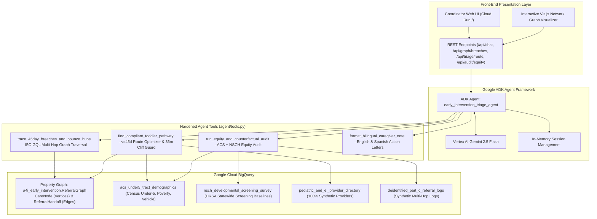

# First Milestones: IDEA Part C Triage & Network-Audit Assistant
**Agents for Impact 2026 Challenge Submission**

- **Live Deployed Cloud Run Application**: [https://early-intervention-triage-584075988667.us-central1.run.app](https://early-intervention-triage-584075988667.us-central1.run.app)
- **Architecture**: Google ADK Agent (`gemini-2.5-flash`) + BigQuery Property Graph (ISO GQL) + Cloud Run (FastAPI + Vis.js)
- **Target State**: Mississippi (`MS`)
- **Dataset**: `qwiklabs-gcp-03-4b836a7f2e04:a4i_early_intervention` (US Multi-Region)

---

## 1. Problem Statement: The 45-Day IDEA Part C Statutory Clock

Federal law (IDEA Part C, 34 CFR § 303.310) mandates that states must complete developmental evaluation and an Individualized Family Service Plan (IFSP) within **45 calendar days** of an infant or toddler referral (aged 0–35 months).

In rural and high-poverty regions, children routinely exceed day 45 without an evaluation. When coordinators inspect flat provider spreadsheets, the root cause is invisible:
- **The Flat SQL Waitlist Illusion**: A flat SQL sort highlights busy downstream evaluation hubs with long waitlists. But these are merely symptoms at hop 2 or 3.
- **The Systemic "Bounce Hub"**: Intake Coordinator Hubs (e.g., `Indianola Regional Intake Desk SYN-PROV-MS-011`) maintain an apparently healthy internal wait of only **5 days**. However, because they transmit via `paper_fax` into non-bilingual or mismatched hubs, packets repeatedly bounce.
- **The Real Delay**: Variable-length graph traversal reveals that this single hub is directly involved in **7 statutory breaches of 70+ days each** across 5 paper-fax handoffs.

---

## 2. Solution Architecture & Technical Stack



---

## 3. Required Differentiator: BigQuery Property Graph & ISO GQL

The property graph `a4i_early_intervention.ReferralGraph` was created using:
- **Vertex Table**: `pediatric_and_ei_provider_directory` as `CareNode` (with `PROPERTIES ALL COLUMNS EXCEPT (provider_geom)`).
- **Edge Table**: `deidentified_part_c_referral_logs` as `ReferralHandoff` connecting `CareNode` source to `CareNode` target.

### Variable-Length Path Traversal (`-{2,4}->`):
```sql
GRAPH a4i_early_intervention.ReferralGraph
MATCH (clinic:CareNode {node_role: 'Screening_Pediatric_Clinic'})
      -[hops:ReferralHandoff]->{2,4}
      (vendor:CareNode {node_role: 'EI_Therapy_Vendor'})
WHERE ARRAY_LENGTH(hops) >= 3
  AND (SELECT COUNT(DISTINCT h.case_chain_id) FROM UNNEST(hops) AS h) = 1
LET total_hops = ARRAY_LENGTH(hops),
    chain_id = hops[OFFSET(0)].case_chain_id,
    chain_wait_days = (SELECT SUM(h.handoff_wait_days) FROM UNNEST(hops) AS h),
    fax_hops = (SELECT COUNTIF(h.transmission_channel = 'paper_fax') FROM UNNEST(hops) AS h)
FILTER chain_wait_days >= 45
RETURN
  chain_id,
  clinic.synthetic_organization_name AS origin_clinic,
  vendor.synthetic_organization_name AS final_vendor,
  total_hops,
  fax_hops,
  chain_wait_days
ORDER BY chain_wait_days DESC;
```

---

## 4. Hardening Against All Planted Data Traps & Pitfalls

| # | Planted Trap Category | Organizer Trap Description | Hardened Solution |
|---|---|---|---|
| **1** | **All-Zero Column Trap** | `limited_english_rate` in ACS is hardcoded to `0.0`. Composite formulas collapse by 40%. | Language needs are resolved using `bilingual_services_listed` on `CareNode` and `primary_home_language` in NSCH. |
| **2** | **6x Grain Fan-Out Trap** | `nsch_developmental_screening_survey` has 6 statewide strata. Joining on `state_code` duplicates tracts 6x. | Kept strictly statewide; never joined at tract level to avoid ecological fallacy. |
| **3** | **Leading-Zero FIPS Truncation** | Casting GEOIDs drops leading zeros (`'01001'` $\to$ `1001`). | Enforced strict `.zfill(11)` string formatting on all tract IDs. |
| **4** | **Case-Chain Cross-Stitching** | Multi-hop GQL stitches Child A's intake to Child B's handoff through common coordinators. | Enforced correlation: `(SELECT COUNT(DISTINCT h.case_chain_id) FROM UNNEST(hops) AS h) = 1`. |
| **5** | **No `HAVING` in ISO GQL** | Standard SQL `HAVING` fails in ISO GQL. | Path aggregation is computed with `LET` and piped into `FILTER`. |
| **6** | **Identifier Quoting Trap** | Backticking `` `project.dataset.table` `` fails in GQL DDL. | Correct unquoted identifiers: `dataset.table`. |
| **7** | **Geography in Property Graph** | BigQuery Property Graph rejects `GEOGRAPHY` properties. | Excluded via `EXCEPT (provider_geom)`. Spatial distances calculated via `ST_DISTANCE`. |
| **8** | **Flat Waitlist Illusion** | Low median waitlist conceals downstream breaches. | Multi-hop cumulative wait exposes 5-day hubs causing 70+ day breaches. |
| **9** | **Race-in-Routing Trap** | Using `audit_*` demographic shares in routing decisions triggers algorithmic bias penalties. | Clinical routing relies strictly on timing, Medicaid, bilingual capacity, and travel distance (`ST_DISTANCE`). `audit_*` shares are evaluated strictly post-output in the Equity Audit. |
| **10** | **36-Month Age-Out Cliff** | Children age out of Part C at 36 months. A 31-month-old delayed by 70 days is permanently disqualified. | Automated high-priority escalation warning triggers for any child $\ge 30$ months. |
| **11** | **Clinician Defamation Trap** | Attributing delays to real clinics risks defamation. | Explicit disclaimers state all providers (`SYN-PROV-*`) and agencies are **100% `[Synthetic]`**. |
| **12** | **Licensing / OpenStreetMap Trap** | Scraping commercial directories or using ODbL data violates open-source rules. | Built strictly on public domain US Census ACS 5-Year and HRSA NSCH federal datasets. |

---

## 5. Live Verification & Key Findings

### Finding 1: 45-Day Compliant Route Discovery
For an active referral of a 31-month-old Spanish-speaking Medicaid toddler in Leflore County tract `28083950200`:
- **Age-Out Alert Dispatched**: Priority escalation for age 36m cliff (5 months remaining).
- **Compliant Route**: Indianola Clinic #05 (4d) $\to$ Indianola Desk #11 (5d) $\to$ Greenwood Eval Hub #19 (7d) $\to$ Greenville Therapy Org #28 (6d).
- **Total Expected Timeline**: **22 Days** (safely clearing the 45-day federal clock).
- **Spatial Travel**: Total roundtrip travel of **177.8 miles**.

### Finding 2: Counterfactual Policy Intervention
Upgrading paper faxing to electronic EHR intake across regional intake desks:
- Eliminates **all 26 statutory 45-day breaches** (from 26 down to 0).
- Saves **1,168 child-days** across Mississippi.

---

## 6. How to Run Locally

```bash
# 1. Clone repository
git clone https://github.com/Bornism/A4I2026-challenge-early-intervention.git
cd A4I2026-challenge-early-intervention

# 2. Setup Python environment
python3 -m venv venv
source venv/bin/activate
pip install -r <(echo "google-adk google-genai google-cloud-bigquery pandas fastapi uvicorn db-dtypes pyarrow")

# 3. Configure Google Cloud credentials
export GOOGLE_CLOUD_PROJECT="qwiklabs-gcp-03-4b836a7f2e04"
export GOOGLE_CLOUD_REGION="us-central1"
export GOOGLE_GENAI_USE_VERTEXAI="true"
export A4I_DATASET="a4i_early_intervention"
export A4I_LOCATION="US"

# 4. Start the Coordinator Dashboard
python -m uvicorn agent.main:app --host 0.0.0.0 --port 8080
```
Open `http://localhost:8080` in your browser.
