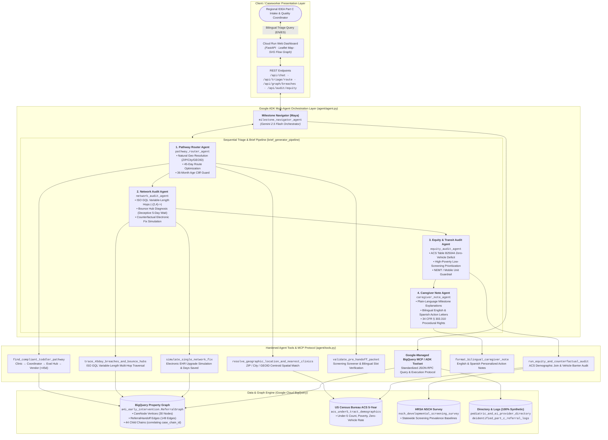

# Milestone Navigator: ADK Multi-Agent Architecture

This package implements **Milestone Navigator (*Maya*)**, an empathetic, expert AI Casework Partner designed for Regional IDEA Part C Intake & Quality Coordinators. Built on the **Google Agent Development Kit (ADK)** and powered by **Vertex AI Gemini 2.5 Flash**, the system traverses BigQuery Property Graphs using ISO GQL to enforce the 45-day federal statutory evaluation deadline (34 CFR § 303.310).

---

## 1. Multi-Agent Architecture Diagram

---

## 2. Multi-Agent Hierarchy

### Root Orchestrator: `milestone_navigator_agent` (*Maya*)
- **Role**: Empathic AI Casework Partner and primary conversational interface.
- **Capabilities**:
  - Directs caseworker queries to specialized subagents.
  - Enforces IDEA Part C statutory guardrails (45-day evaluation limit & 36-month age cliff).
  - Supports fluent, clinically accurate English & Spanish interactions.
  - Formats clinical recommendations into immediate actionable next steps.

### Specialized Pipeline: `brief_generator_pipeline` (`SequentialAgent`)
1. **`pathway_router_agent`**:
   - Resolves natural geographic inputs (ZIP codes, city names, census tracts).
   - Traverses the BigQuery Property Graph to find optimal 4-hop routes (`Clinic -> Coordinator -> Eval Hub -> Vendor`) within 45 days.
   - Pre-flight checks intake packets (`validate_pre_handoff_packet`) to prevent re-referral loops.
2. **`network_audit_agent`**:
   - Executes multi-hop ISO GQL traversals (`trace_45day_breaches_and_bounce_hubs`) to isolate regional bounce hubs.
   - Simulates counterfactual interventions (`simulate_single_network_fix`), showing how upgrading a paper-fax coordinator to electronic intake rescues breached cases and saves child-days.
3. **`equity_audit_agent`**:
   - Evaluates neighborhood socioeconomic barriers using Census ACS Table B25044 data (`run_equity_and_counterfactual_audit`).
   - Flags zero-vehicle transit deficits and prescribes Mobile Evaluation Units or NEMT vouchers.
4. **`caregiver_note_agent`**:
   - Synthesizes routing and clinical results into clear, culturally responsive family action letters in English and Spanish (`format_bilingual_caregiver_note`).

---

## 3. Tool Suite (`agent/tools.py`)

| Tool Name | Purpose | Data Source |
|---|---|---|
| `resolve_geographic_location_and_nearest_clinics` | Geocodes ZIP / City / GEOID to tract centroid and finds nearest pediatric clinics using `ST_DISTANCE` | ACS Demographics & Provider Directory |
| `find_compliant_toddler_pathway` | Traverses graph to identify compliant <=45-day pathways matching Medicaid and language | BigQuery `ReferralGraph` |
| `trace_45day_breaches_and_bounce_hubs` | Traverses variable-length `-{2,4}->` paths correlated on `case_chain_id` to identify bottlenecks | BigQuery `ReferralGraph` (ISO GQL) |
| `simulate_single_network_fix` | Counterfactual impact simulation of upgrading a coordinator hub from paper fax to e-referral | BigQuery Referral Logs |
| `validate_pre_handoff_packet` | Pre-flight validation of developmental screener scores, consent, and language mandates | Clinical Intake Guardrails |
| `run_equity_and_counterfactual_audit` | Post-routing audit joining child tract with ACS poverty & zero-vehicle rates | ACS & NSCH Survey |
| `format_bilingual_caregiver_note` | Generates plain-language English & Spanish family action letters with procedural rights | Clinical Template & Gemini |

---

## 4. Guardrails & Technical Trap Defenses

1. **Synthetic Data Protection**: All 30 provider directory entries and 149 referral handoffs are 100% synthetic (`SYN-PROV-*`) to protect real clinical entities from defamation.
2. **Census ACS vs. NSCH Grain**: NSCH developmental survey baselines are strictly **statewide** (6 modeled strata). Joining on state code without stratification causes a 6x duplicate fan-out; the tools handle NSCH strictly as an independent statewide baseline.
3. **All-Zero Column Trap**: ACS `limited_english_rate` is `0.0` everywhere. The agent evaluates language capability using `primary_home_language` and `bilingual_services_listed`.
4. **Leading-Zero Preservation**: All GEOIDs (11 chars) and county FIPS (5 chars) are preserved as zero-padded strings.
5. **Age Cliff Guardrail**: Children aged $\ge 36$ months are safeguarded against unlawful Part C enrollment and routed immediately to Part B § 619 Preschool CPSE transitions.
